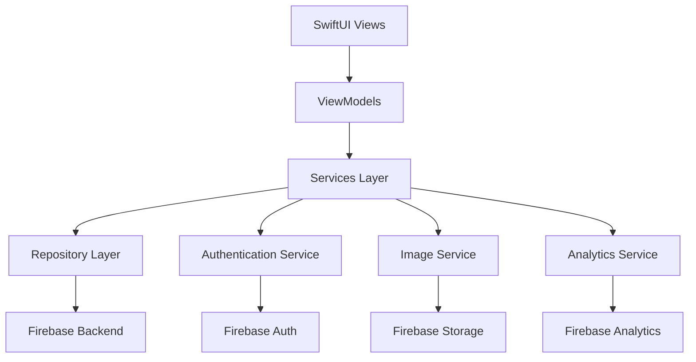
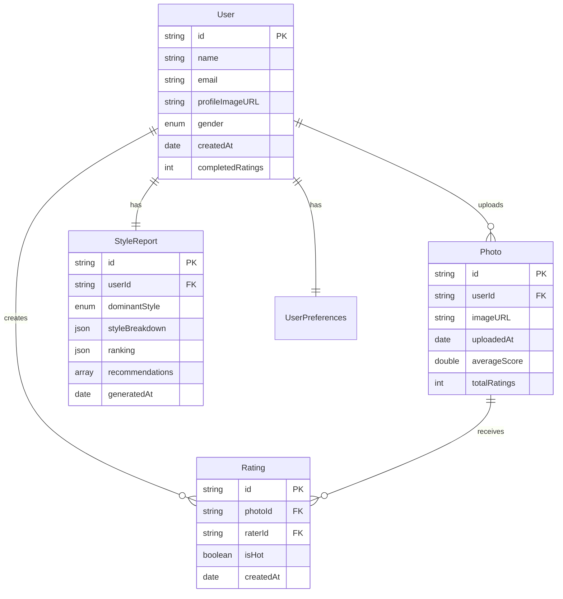

# Design Document

## Overview

數位頂尖社交評價平台是一個基於 SwiftUI 的 iOS 應用程式，採用 MVVM 架構模式和現代 iOS 開發最佳實踐。應用程式的核心流程是引導用戶通過評分其他人的照片來解鎖上傳自己照片的功能，最終獲得個性化的風格分析報告。

### 技術棧

- **UI Framework**: SwiftUI with iOS 16+ modern APIs (AsyncImage, NavigationStack)
- **Architecture**: MVVM + Clean Architecture (每個 Swift 檔案嚴格限制 500 行以內)
- **Authentication**: Firebase Auth (Google/Apple Sign-In)
- **Backend**: Firebase Firestore with offline persistence
- **Image Storage**: Firebase Storage (僅存儲 WebP 格式，禁止原檔)
- **State Management**: Combine + @StateObject/@ObservedObject + async/await
- **Networking**: URLSession + async/await + Combine
- **Image Processing**: Core Image + WebP conversion (libwebp)
- **Performance**: Instruments profiling + SwiftUI ViewBuilder optimization
- **Analytics**: Firebase Analytics + Performance Monitoring

## Architecture

### 整體架構圖



### MVVM 架構設計

- **Models**: 數據模型和業務邏輯 (每個檔案 < 500 行)
- **Views**: SwiftUI 視圖組件，採用 ViewBuilder 和 @ViewBuilder 優化
- **ViewModels**: 視圖狀態管理和業務邏輯協調，使用 @MainActor
- **Services**: 外部服務集成（認證、存儲、分析），支援 async/await
- **Repositories**: 數據訪問抽象層，實現 Protocol-oriented programming
- **Requirement**: 程式註釋保持英文
- 不要用 UIKit
- 用 swift package 支援的第三方套件

### 代碼結構要求

- **檔案大小限制**: 每個 Swift 檔案嚴格控制在 500 行以內
- **模組化設計**: 功能拆分為獨立的小型檔案
- **現代化 UI**: 使用 iOS 16+ 的最新 SwiftUI 特性
- **性能優先**: 所有 UI 操作保持 60fps 流暢度
- **記憶體效率**: 圖片記憶體使用控制在 100MB 以內

## Components and Interfaces

### 1. Authentication Module

#### AuthenticationService

```swift
protocol AuthenticationServiceProtocol {
    func signInWithGoogle() async throws -> User
    func signInWithApple() async throws -> User
    func signOut() async throws
    var currentUser: User? { get }
    var isAuthenticated: Bool { get }
}
```

#### User Model

```swift
struct User: Codable, Identifiable {
    let id: String
    let name: String
    let email: String
    let profileImageURL: String?
    let gender: Gender?
    let createdAt: Date
    var ratingProgress: RatingProgress
    var uploadedPhotos: [Photo]
}

struct RatingProgress: Codable {
    var completedRatings: Int
    var requiredRatings: Int = 20
    var hasUnlockedUpload: Bool { completedRatings >= requiredRatings }
}
```

### 2. Photo Rating Module

#### PhotoRatingService

```swift
protocol PhotoRatingServiceProtocol {
    func fetchPhotosForRating(excludingUser userId: String) async throws -> [Photo]
    func submitRating(_ rating: Rating) async throws
    func updateUserPreferences(from ratings: [Rating]) async throws
}
```

#### Photo Model

```swift
struct Photo: Codable, Identifiable {
    let id: String
    let userId: String
    let imageURL: String
    let uploadedAt: Date
    let dateTaken: Date?           // 從 EXIF 讀取的實際拍攝時間
    let isVerifiedRecent: Bool     // 是否驗證為近期照片
    var ratings: [Rating]
    var averageScore: Double
    var totalRatings: Int
}

struct Rating: Codable, Identifiable {
    let id: String
    let photoId: String
    let raterId: String
    let isHot: Bool // true for "Hot", false for "Not"
    let createdAt: Date
}
```

### 3. Photo Upload Module

#### PhotoUploadService

```swift
protocol PhotoUploadServiceProtocol {
    func uploadPhoto(_ image: UIImage, for userId: String) async throws -> Photo
    func convertToWebP(_ image: UIImage, quality: Float) async throws -> Data
    func generateThumbnails(_ image: UIImage) async throws -> PhotoSizes
    func extractEXIFData(_ image: UIImage) async throws -> PhotoMetadata
    func validatePhotoFreshness(_ metadata: PhotoMetadata) async throws -> Bool
    func getUploadProgress(for photoId: String) async throws -> UploadProgress
}

struct PhotoSizes: Codable {
    let thumbnail: Data    // 150x150 WebP, 高壓縮
    let preview: Data      // 800x800 WebP, 中等品質
    let highRes: Data      // 1200x1200 WebP, 高品質
}

struct PhotoMetadata: Codable {
    let dateTaken: Date?           // 從 EXIF 讀取的拍攝日期
    let cameraModel: String?       // 相機型號（用於驗證真實性）
    let isRecentPhoto: Bool        // 是否為近期照片（24小時內）
    let hasValidEXIF: Bool         // 是否包含有效的 EXIF 資料
    // 注意：位置資訊等敏感資料不會被保存
}

struct UploadProgress: Codable {
    let photoId: String
    var currentRatings: Int
    let requiredRatings: Int = 50
    var isReportUnlocked: Bool { currentRatings >= requiredRatings }
}
```

### 4. Style Analysis Module

#### StyleAnalysisService

```swift
protocol StyleAnalysisServiceProtocol {
    func generateStyleReport(for userId: String) async throws -> StyleReport
    func getUserPreferences(for userId: String) async throws -> UserPreferences
}

struct StyleReport: Codable, Identifiable {
    let id: String
    let userId: String
    let dominantStyle: StyleType
    let styleBreakdown: [StyleType: Double]
    let ranking: StyleRanking
    let recommendations: [String]
    let generatedAt: Date
}

enum StyleType: String, CaseIterable, Codable {
    case elegant = "優雅"
    case casual = "休閒"
    case trendy = "時尚"
    case classic = "經典"
    case sporty = "運動"
    case artistic = "藝術"
}
```

### 5. Gamification Module

#### GamificationService

```swift
protocol GamificationServiceProtocol {
    func updateUserProgress(_ progress: UserProgress) async throws
    func checkAchievements(for userId: String) async throws -> [Achievement]
    func getIncentiveStatus(for userId: String) async throws -> IncentiveStatus
}

struct IncentiveStatus: Codable {
    var acceleratedRatingsAvailable: Int
    var nextAcceleratedRatingAt: Int // ratings needed
    var evolutionAnalysisUnlocked: Bool
    var shareRewardsUnlocked: Bool
}
```

## Data Models

### Core Data Relationships



### Firebase Firestore Collections Structure

```
users/
  {userId}/
    - profile data
    - ratingProgress
    - preferences

photos/
  {photoId}/
    - photo metadata
    - ratings subcollection

ratings/
  {ratingId}/
    - rating data

styleReports/
  {userId}/
    - latest style report

achievements/
  {userId}/
    - user achievements
```

## Error Handling

### Error Types

```swift
enum AppError: Error, LocalizedError {
    case authenticationFailed
    case networkError(Error)
    case imageUploadFailed
    case insufficientRatings
    case reportGenerationFailed
    case invalidImageFormat

    var errorDescription: String? {
        switch self {
        case .authenticationFailed:
            return "登入失敗，請重試"
        case .networkError:
            return "網路連接問題，請檢查網路設定"
        case .imageUploadFailed:
            return "照片上傳失敗，請重試"
        case .insufficientRatings:
            return "評分數量不足，無法生成報告"
        case .reportGenerationFailed:
            return "報告生成失敗，請稍後重試"
        case .invalidImageFormat:
            return "不支援的圖片格式"
        }
    }
}
```

### Error Handling Strategy

- **Network Errors**: 自動重試機制，最多 3 次
- **Authentication Errors**: 引導用戶重新登入
- **Upload Errors**: 提供重試選項和進度恢復
- **Validation Errors**: 即時用戶反饋和指導

## Testing Strategy

### 單元測試 (Unit Tests)

- **ViewModels**: 測試狀態管理和業務邏輯
- **Services**: 測試 API 調用和數據處理
- **Models**: 測試數據驗證和轉換
- **Utilities**: 測試輔助函數和擴展

### 整合測試 (Integration Tests)

- **Firebase Integration**: 測試認證和數據同步
- **Image Upload Flow**: 測試完整的上傳流程
- **Rating System**: 測試評分計算和更新

### UI 測試 (UI Tests)

- **User Flow Testing**: 測試完整的用戶流程
- **Accessibility Testing**: 確保應用程式的可訪問性
- **Performance Testing**: 測試滑動和圖片載入性能

### 測試數據管理

- **Mock Services**: 為單元測試提供模擬數據
- **Test Fixtures**: 預定義的測試數據集
- **Firebase Emulator**: 本地測試環境

## Performance Considerations

### 圖片處理優化

- **WebP Conversion**: 所有上傳圖片自動轉換為 WebP 格式，減少 60-80% 文件大小
- **Smart Compression**: 多級壓縮策略 - 縮圖(150x150)、預覽(800x800)、高清(1200x1200)
- **No Original Storage**: 絕不存儲原始圖片到 Firebase Storage，只保存壓縮後的 WebP 格式
- **Advanced Caching**: 使用 Kingfisher 配合 WebP 支援進行智能緩存
- **Progressive Loading**: 先載入低質量版本，再漸進式提升清晰度
- **Smart Preloading**: 基於用戶滑動速度智能預載 3-5 張圖片
- **Memory Optimization**: 自動釋放不在視窗內的圖片，保持記憶體使用低於 100MB

### 數據同步優化

- **Offline Support**: 本地數據緩存和離線操作
- **Batch Operations**: 批量提交評分數據
- **Real-time Updates**: 使用 Firebase 實時監聽器
- **Data Pagination**: 分頁載入歷史數據

### 記憶體管理

- **Weak References**: 避免循環引用
- **Image Memory Management**: 及時釋放不需要的圖片
- **Background Processing**: 後台處理重型任務

## Security and Privacy

### 數據保護

- **Image Encryption**: 敏感圖片加密存儲
- **EXIF Data Processing**:
  - 讀取拍攝日期和相機資訊用於驗證照片新鮮度
  - 自動移除位置、設備序號等敏感 EXIF 資料
  - 只保留必要的時間戳記和基本相機資訊
  - 存儲到 Firebase 的圖片完全清除 EXIF 資料
- **Photo Freshness Validation**:
  - 驗證照片是否在 24 小時內拍攝
  - 檢測是否為螢幕截圖或編輯過的圖片
  - 確保用戶上傳的是真實近期照片
- **User Data Anonymization**: 評分數據匿名化
- **Secure API Communication**: HTTPS 和 API 密鑰保護

### 隱私合規

- **GDPR Compliance**: 用戶數據刪除和導出功能
- **Privacy Policy**: 清晰的隱私政策說明
- **Consent Management**: 用戶同意管理系統
- **Data Minimization**: 只收集必要的用戶數據

### 內容審核

- **Automated Moderation**: 使用 ML 檢測不當內容
- **User Reporting**: 用戶舉報機制
- **Manual Review**: 人工審核可疑內容
- **Content Guidelines**: 清晰的社群準則

## Modern UI Design Requirements

### 視覺設計

- **Design System**: 採用 iOS 16+ 原生設計語言
- **Color Palette**: 動態顏色支援 Light/Dark Mode
- **Typography**: SF Pro 字體系統，支援動態字體大小
- **Animations**: 流暢的 SwiftUI 動畫，60fps 保證
- **Accessibility**: 完整的 VoiceOver 和動態字體支援

### 互動設計

- **Gesture-First**: 優先考慮手勢操作（滑動評分）
- **Haptic Feedback**: 適當的觸覺反饋增強體驗
- **Loading States**: 優雅的載入狀態和骨架屏
- **Error Handling**: 友善的錯誤提示和恢復機制
- **Progressive Disclosure**: 漸進式資訊揭露

### 性能要求

- **60fps UI**: 所有動畫和滑動保持 60fps
- **快速啟動**: 應用程式啟動時間 < 2 秒
- **記憶體控制**: 峰值記憶體使用 < 150MB
- **網路優化**: 圖片載入時間 < 1 秒
- **離線支援**: 核心功能支援離線使用
